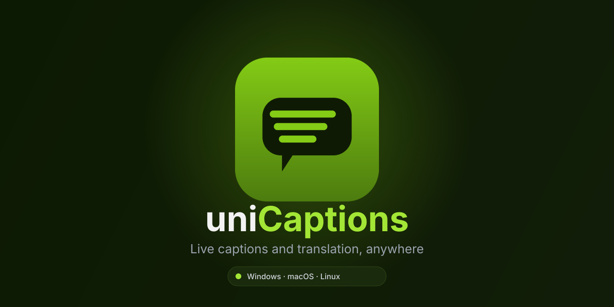

<p align="center">
  
</p>

<p align="center">
  <b>Live captions and translation, anywhere.</b><br />
  A lightweight, cross-platform desktop overlay that captions your microphone or system audio in real time — locally or in the cloud.
</p>

<p align="center">
  Windows · macOS · Linux
</p>

---

## Features

- **Live captions** from your microphone or system audio (e.g. video calls, media playback)
- **Local speech recognition** via [whisper.cpp](https://github.com/ggerganov/whisper.cpp) — offline, private, free — with selectable model sizes (tiny → medium), GPU-accelerated through Vulkan on Windows
- **Cloud speech recognition** via the OpenAI Whisper API, if you'd rather trade privacy for accuracy on lower-power machines
- **Live translation** into another language as captions appear, locally via ONNX Runtime ([Helsinki-NLP OPUS-MT](https://huggingface.co/Helsinki-NLP)) or via the DeepL API
- **Fully configurable overlay**: font (any installed system font), size, weight, color, background, outline, position, and click-through behavior
- **System tray** support, autostart on login, and an optional "start captioning automatically" switch
- **8 supported UI languages**: English, Spanish, French, German, Polish, Portuguese, Chinese, Japanese

> **Platform note:** capturing *system audio* (loopback) is currently implemented on Windows only. On macOS and Linux, use the microphone source.

## Getting started

uniCaptions is a single native Rust binary — no Node.js, no WebView.

### Prerequisites

- [Rust](https://rustup.rs/) (stable toolchain)
- `cmake` and LLVM (`libclang`) — required by `whisper-rs` and `ort` at build time
- **Windows:** the [Vulkan SDK](https://vulkan.lunarg.com/) (with `glslc`) for GPU-accelerated Whisper. At runtime it falls back to the CPU when no Vulkan device is present.
- **Linux:** `pkg-config libasound2-dev libdbus-1-dev libgtk-3-dev libayatana-appindicator3-dev libxdo-dev`

### Development

```sh
cargo run -p unicaptions          # run the app
cargo test --workspace            # unit + headless UI tests
cargo clippy --workspace --all-targets -- -D warnings
```

Set `UNICAPTIONS_HOME=<folder>` to keep all settings, models and window state in that folder (handy for a portable install, or to try the app without touching your real settings).

> **Windows tip:** whisper.cpp's Vulkan shader build nests very deep. If the build fails with `FTK1011` / path-too-long errors, build with a short target directory, e.g. `set CARGO_TARGET_DIR=C:\ct`.

<details>
<summary>End-to-end tests against the real models</summary>

These download hundreds of MB and are `#[ignore]`d by default:

```sh
export UNICAPTIONS_TEST_HOME=/tmp/unicaptions-e2e      # models are cached here
export UNICAPTIONS_TEST_WAV=/path/to/english-speech.wav
cargo test --release -p unicaptions-core --test e2e_models -- --ignored --nocapture
```

On Windows the suite also plays the WAV through your speakers and checks that WASAPI loopback → Whisper → captions works.

</details>

### Building installers

Installers are produced with [`cargo-packager`](https://crates.io/crates/cargo-packager):

```sh
cargo install cargo-packager --locked
cd crates/app
cargo packager --release              # NSIS (Windows), DMG (macOS), deb + AppImage (Linux)
```

Output lands in `dist/`. Pushing a `v*` tag runs the **Release** workflow, which builds installers for all three platforms and attaches them to the GitHub release.

## How it works

Audio is captured via [`cpal`](https://github.com/RustAudio/cpal) (microphone) or WASAPI loopback (system audio on Windows), resampled to 16 kHz mono, and streamed through a rolling buffer to the active speech recognition backend. Recognized text is optionally passed through a translation backend and pushed to a transparent, always-on-top overlay window, independent from the main Settings window.

Speech and translation models are downloaded on demand into the app's data directory the first time they're used, and can be managed (downloaded/deleted) from the **Models** tab. API keys are stored in the OS credential store (Windows Credential Manager, macOS Keychain, Secret Service on Linux) — never in the settings file.

The code is a Cargo workspace:

| Crate | Role |
|---|---|
| `crates/core` | GUI-free engine: audio capture, Whisper/OPUS-MT/cloud backends, settings, model management, event stream |
| `crates/app` | The `egui`/`eframe` application: Settings window, caption overlay, tray, i18n, fonts |

## Tech stack

| | |
|---|---|
| UI | [egui](https://github.com/emilk/egui) / `eframe` (OpenGL) |
| Local speech recognition | [whisper.cpp](https://github.com/ggerganov/whisper.cpp) via `whisper-rs` |
| Local translation | [ONNX Runtime](https://onnxruntime.ai/) (`ort`) running Helsinki-NLP OPUS-MT models |
| Audio capture | `cpal`, `wasapi` |
| Tray / autostart | `tray-icon`, `auto-launch` |
| Packaging | `cargo-packager` |

## Author

Created by [RikoDEV](https://riko.dev)
